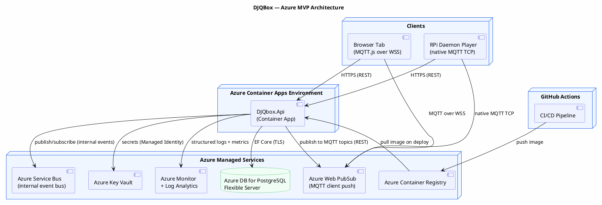

# DJQBox — MVP Azure Promotion Plan

## Purpose

This document describes the promotion path from the local POC to a production-grade MVP running on Azure. It maps each logical DJQBox component to the appropriate Azure service, defines what changes between POC and MVP, and provides a task breakdown for the promotion work.

It is intended to be handed to a coding agent or developer after the POC is validated locally.

See [ADR-011](../adr/ADR-011-messaging-architecture.md) for the rationale behind the messaging architecture choices.

---

## What Changes, What Stays the Same

### Stays the same
- All .NET application code (Minimal API, EF Core, domain logic)
- All endpoint contracts and data shapes (spec-defined, cloud-agnostic)
- All integration tests (run against a local Postgres in CI)
- The dummy frontend (`index.html`) — gains MQTT.js client in place of SignalR JS client

### Changes in MVP

| POC | MVP |
|---|---|
| `docker compose up` on local machine | Azure Container Apps (managed container runtime) |
| Postgres in Docker container | Azure Database for PostgreSQL — Flexible Server |
| In-process pub/sub event bus | Azure Service Bus (internal) + Azure Web PubSub MQTT (client push) |
| In-process veto timer (`IHostedService`) | Kept in-process for MVP; Service Bus used for cross-service events |
| Static JWT signing key in `appsettings` | Azure Key Vault (secret reference via Managed Identity) |
| Stdout logs | Azure Monitor + Log Analytics + Application Insights |
| Static pre-seeded tokens | Real JWT auth — owner login + guest QR join |
| Local file tracks (seeded DB) | Extend to Spotify adapter (optional for MVP) |
| Manual `docker compose` deploy | GitHub Actions CI/CD → Azure Container Registry → Container Apps |

---

## Azure Architecture



---

## Azure Service Mapping

| Spec Component | POC (local) | Azure MVP |
|---|---|---|
| API Gateway + all services | Single .NET process | Azure Container Apps (single revision) |
| PostgreSQL database | Docker `postgres:16` | Azure Database for PostgreSQL Flexible Server (Burstable B2ms) |
| Internal Event Bus | In-process pub/sub | Azure Service Bus (Standard tier, topics + subscriptions) |
| Client push | In-process SignalR hub | Azure Web PubSub (MQTT 3.1.1/5.0, Free tier) |
| Container registry | Local Docker daemon | Azure Container Registry (Basic tier) |
| Secrets (JWT key, DB string) | `appsettings.Development.json` | Azure Key Vault + Managed Identity |
| Logging | Stdout | Azure Monitor + Log Analytics + Application Insights |
| Frontend hosting | Local file open in browser | Azure Static Web Apps (free tier) |
| CI/CD | Manual `docker compose` | GitHub Actions workflow |
| Auth | Static pre-seeded tokens | Real JWT — owner login + guest QR token |

---

## Messaging Architecture Detail

### Internal Event Bus — Azure Service Bus

The API publishes domain events to Service Bus topics. In the MVP (single process), the same process also subscribes. This pattern is forward-compatible with a future split into microservices.

**Topics and subscriptions:**

| Topic | Subscription | Consumer | Purpose |
|---|---|---|---|
| `queue-events` | `api-queue-consumer` | API process | Queue mutations → trigger client push |
| `recommendation-events` | `api-rec-consumer` | API process | Recommendation lifecycle → trigger client push |
| `playback-events` | `api-playback-consumer` | API process | Player state changes → update Now Playing |
| `profile-events` | `api-profile-consumer` | API process | Feedback events → update Music Profile weights |

**NuGet:** `Azure.Messaging.ServiceBus`

**Pattern in code:**
```csharp
// Publishing (Queue Service)
await serviceBusSender.SendMessageAsync(new ServiceBusMessage(
    JsonSerializer.Serialize(new QueueUpdatedEvent(venueId, changedItemIds))
) { Subject = "queue.updated" });

// Subscribing (Background service processor)
await serviceBusProcessor.StartProcessingAsync();
// On message received → forward to Web PubSub
```

---

### Client Push — Azure Web PubSub (MQTT)

The API publishes to MQTT topics via the Web PubSub REST API. Clients subscribe directly to Web PubSub over MQTT.

**MQTT topic structure:**
```
venues/{venueId}/queue.updated
venues/{venueId}/nowplaying.changed
venues/{venueId}/recommendation.received
venues/{venueId}/recommendation.promoted
venues/{venueId}/mode.changed
venues/{venueId}/player/{playerId}/heartbeat
venues/{venueId}/player/{playerId}/state
```

**Client types:**
- Browser tab: MQTT.js library over WSS (`wss://djqbox.webpubsub.azure.com`)
- RPi daemon: native MQTT TCP client (`mqtt://djqbox.webpubsub.azure.com:8883`)

**NuGet (server-side publish):** `Azure.Messaging.WebPubSub`

**Pattern in code:**
```csharp
// Server publishes to MQTT topic via REST
await webPubSubClient.SendToGroupAsync(
    group: $"venue:{venueId}",
    content: BinaryData.FromObjectAsJson(payload),
    contentType: ContentType.ApplicationJson
);
```

**Client token issuance:** The API issues connection tokens scoped to the client's venue group:
```
GET /api/v1/venues/{venueId}/mqtt-token
→ { endpoint: "wss://...", token: "...", topics: ["venues/{id}/#"] }
```

**Frontend change (from POC):** Replace SignalR JS client with MQTT.js:
```javascript
// Before (POC)
const connection = new signalR.HubConnectionBuilder()
    .withUrl("/hubs/venue").build();

// After (MVP)
const client = mqtt.connect(mqttConfig.endpoint, {
    username: mqttConfig.token,
    clientId: 'browser-' + crypto.randomUUID()
});
client.subscribe(`venues/${venueId}/#`);
client.on('message', (topic, payload) => { /* handle event */ });
```

---

## What MVP Adds to the POC

### Must-haves for MVP

1. **Service Bus integration** — Replace in-process pub/sub with Azure Service Bus topics. Publish domain events from services; consume in background processors that forward to Web PubSub.

2. **Web PubSub MQTT integration** — Replace in-process SignalR hub with Azure Web PubSub MQTT. API publishes to MQTT topics; clients connect directly to Web PubSub.

3. **MQTT token endpoint** — `GET /api/v1/venues/{id}/mqtt-token` issues a scoped connection token for the client to connect to Web PubSub directly.

4. **Real auth flow** — Owner login via email/password (DB-backed for MVP, WebAuthn post-MVP); guest QR join with a generated signed token URL.

5. **Multi-venue support** — Venue CRUD endpoints. Each venue has its own queue, mode, and music profile.

6. **Key Vault for secrets** — JWT signing key, database connection string, Service Bus connection string, Web PubSub connection string all in Key Vault. No secrets in code or env vars.

7. **CI/CD pipeline** — GitHub Actions: build image → push to ACR → run migrations → update Container App revision.

8. **Structured logging to Azure Monitor** — Serilog Application Insights sink. Request traces, domain event custom metrics.

9. **HTTPS enforced** — Container Apps TLS termination + HTTPS redirect in app.

10. **Database migrations in CI** — `dotnet ef database update` in the pipeline, not at app startup.

### Nice-to-haves for MVP

- Spotify adapter integration
- Music Profile scoring feedback loop
- Full WebAuthn/passkey owner auth
- RPi daemon player (connects via native MQTT TCP to Web PubSub)

---

## Task Breakdown

### Task A — Azure Infrastructure (Bicep)

**Goal:** All Azure resources provisioned via Bicep. No manual portal steps.

**Resources:**
```
Resource Group: rg-djqbox-mvp

Azure Container Registry:         crdjqboxmvp (Basic)
Azure Database for PostgreSQL:     psql-djqbox-mvp (Burstable B2ms, Postgres 16)
Azure Key Vault:                   kv-djqbox-mvp
  Secrets: JwtSigningKey, DbConnectionString,
           ServiceBusConnectionString, WebPubSubConnectionString
Azure Service Bus Namespace:       sb-djqbox-mvp (Standard)
  Topics: queue-events, recommendation-events, playback-events, profile-events
  Subscriptions: api-* (one per topic)
Azure Web PubSub:                  wps-djqbox-mvp (Free tier, MQTT enabled)
Azure Container Apps Environment:  cae-djqbox-mvp (Log Analytics attached)
Azure Container App:               ca-djqbox-api
  Managed Identity: system-assigned
  Min replicas: 1, Max: 3
  Ingress: external HTTPS port 8080
Azure Static Web Apps:             swa-djqbox-frontend (Free)
```

**Acceptance:** `az deployment group create --template-file infra/main.bicep` completes. `GET https://ca-djqbox-api.azurecontainerapps.io/health` returns `200`.

---

### Task B — Service Bus Integration

**Goal:** Replace in-process pub/sub with Azure Service Bus. Domain events flow through Service Bus topics.

**Implementation:**
1. Add `Azure.Messaging.ServiceBus` NuGet package.
2. Create `IEventBus` interface with `PublishAsync<T>(T event)` and `SubscribeAsync<T>(Func<T, Task> handler)`.
3. Implement `InProcessEventBus` (POC — existing in-process, kept for local dev).
4. Implement `ServiceBusEventBus` (MVP — publishes to Service Bus topics, subscribes via `ServiceBusProcessor` background service).
5. Registration: `IEventBus` resolves to `InProcessEventBus` when `Azure:ServiceBus:ConnectionString` is absent; resolves to `ServiceBusEventBus` when present.
6. All existing service code that currently calls SignalR hub directly is refactored to call `IEventBus.PublishAsync(...)`.

**Acceptance:** On Azure, publish a recommendation. Confirm Service Bus Explorer shows the message on `recommendation-events` topic. Confirm the API consumer picks it up and forwards to Web PubSub.

---

### Task C — Web PubSub MQTT Integration

**Goal:** Replace in-process SignalR with Azure Web PubSub MQTT for client push. Existing SignalR hub removed.

**Implementation:**
1. Add `Azure.Messaging.WebPubSub` NuGet package.
2. Create `IMqttPushService` interface with `PublishToVenueAsync(venueId, topic, payload)`.
3. Implement `WebPubSubMqttPushService` that calls the Web PubSub REST API to publish to MQTT topic groups.
4. Implement `LocalMqttPushService` (POC — uses a local in-process pub/sub or an optional local Mosquitto Docker container).
5. Add `GET /api/v1/venues/{venueId}/mqtt-token` endpoint: issues a scoped Web PubSub client access token, returns the MQTT endpoint URL + token.
6. Remove SignalR hub and `VenueHub.cs`.
7. Update `index.html`: replace SignalR JS client with MQTT.js from CDN. Connect to Web PubSub using the token from `/mqtt-token`. Subscribe to `venues/{venueId}/#`.

**Acceptance:**
- Open two browser tabs. Both connected to Web PubSub via MQTT.
- Submit a recommendation from Tab 1. Tab 2 receives `venues/{id}/recommendation.received` MQTT message in real time.
- Disconnect Tab 2 (simulate offline). Tab 1 submits another recommendation. Reconnect Tab 2 — receives buffered message (QoS 1 persistent session).

---

### Task D — Real Auth (JWT + Key Vault)

**Goal:** Owner login + guest QR join with real JWT. Signing key from Key Vault.

**Implementation:**
1. `POST /auth/login` — accepts `{ email, password }`, validates against `User` table (bcrypt hash), returns JWT.
2. `POST /venues/{id}/token` — admin generates a signed venue token (JWT with guest scopes + venue_id + expiry). Returns `{ venue_token, qr_url }`.
3. `POST /venues/{id}/join` — validates venue token, creates guest Session, returns scoped JWT.
4. `TokenService` uses `Azure.Security.KeyVault.Secrets` + `DefaultAzureCredential` to fetch signing key. Falls back to `appsettings` key when Key Vault is unavailable (local dev).

**Acceptance:** Owner logs in, gets real JWT. Guest scans QR URL, joins without account. Static pre-seeded tokens no longer accepted in MVP environment.

---

### Task E — CI/CD (GitHub Actions)

**Goal:** Merge to `main` → build → test → push image → migrate DB → deploy.

```yaml
# .github/workflows/deploy.yml
on:
  push:
    branches: [main]
jobs:
  deploy:
    runs-on: ubuntu-latest
    steps:
      - uses: actions/checkout@v4
      - uses: azure/login@v1
        with: { creds: '${{ secrets.AZURE_CREDENTIALS }}' }
      - name: Run tests
        run: dotnet test src/DJQbox.Tests
      - name: Build and push image
        run: |
          az acr build --registry crdjqboxmvp \
            --image djqbox-api:${{ github.sha }} ./src/DJQbox.Api
      - name: Run DB migrations
        run: |
          dotnet tool install -g dotnet-ef
          dotnet ef database update --project src/DJQbox.Api \
            -- --connectionString "${{ secrets.DB_CONNECTION_STRING }}"
      - name: Deploy Container App
        run: |
          az containerapp update \
            --name ca-djqbox-api \
            --resource-group rg-djqbox-mvp \
            --image crdjqboxmvp.azurecr.io/djqbox-api:${{ github.sha }}
```

**Acceptance:** Merge triggers pipeline. New image deployed. `GET /health` returns `200` after deploy.

---

### Task F — Observability

**Goal:** Structured logs in Application Insights. Health probes configured on Container App.

**Implementation:**
1. Add `Serilog.Sinks.ApplicationInsights` NuGet.
2. Conditional sink: writes to Application Insights when `APPLICATIONINSIGHTS_CONNECTION_STRING` is set; stdout otherwise.
3. `GET /health` (liveness) and `GET /health/ready` (readiness, checks DB + Service Bus).
4. Container App liveness probe: `GET /health` every 10s.
5. Container App readiness probe: `GET /health/ready` every 10s.
6. Custom Application Insights events for key domain operations (aligned with `docs/spec/11-observability-spec.md`).

**Acceptance:** Azure Portal → Application Insights → Live Metrics shows traffic. `recommendation.promoted` custom events appear in Application Insights Logs.

---

### Task G — Frontend Hosting (Azure Static Web Apps)

**Goal:** `index.html` (MQTT.js version) deployed to Azure Static Web Apps.

**Changes:**
- Add `config.js` with `API_BASE_URL` and `MQTT_ENDPOINT`.
- Static Web Apps deployment via `swa deploy ./frontend`.

**Acceptance:** Open Static Web Apps URL. Full MVP flow works end-to-end against Azure.

---

## Environment Variables Reference

| Variable | Source | Description |
|---|---|---|
| `ConnectionStrings__Default` | Key Vault | Postgres connection string |
| `Jwt__SigningKey` | Key Vault | JWT HS256 signing key (fallback for local dev) |
| `Azure__ServiceBus__ConnectionString` | Key Vault | Service Bus namespace connection string |
| `Azure__WebPubSub__ConnectionString` | Key Vault | Web PubSub connection string |
| `APPLICATIONINSIGHTS_CONNECTION_STRING` | Key Vault | Application Insights |
| `ASPNETCORE_ENVIRONMENT` | Container App setting | `Production` |
| `ASPNETCORE_URLS` | Container App setting | `http://+:8080` |

---

## Cost Estimate (MVP, low traffic)

| Resource | Tier | Est. Monthly Cost |
|---|---|---|
| Azure Container Apps | Consumption, ~1M requests/month | ~$5–15 |
| Azure Database for PostgreSQL | Burstable B2ms | ~$30–40 |
| Azure Service Bus | Standard, ~100k messages/month | ~$1 |
| Azure Web PubSub | Free (20 units, ~400 connections) | $0 |
| Azure Container Registry | Basic | ~$5 |
| Azure Key Vault | Standard, <10k operations | ~$1 |
| Azure Static Web Apps | Free | $0 |
| Azure Monitor / Log Analytics | ~1GB/month | ~$3 |
| **Total** | | **~$45–65/month** |

---

## Definition of Done (MVP)

- [ ] All Azure resources provisioned via Bicep (no manual portal steps).
- [ ] `GET https://ca-djqbox-api.azurecontainerapps.io/health` returns `200`.
- [ ] Owner logs in via `POST /auth/login`, receives real JWT.
- [ ] Guest joins via generated QR token URL.
- [ ] Full flow (recommendation → queue → now-playing) works against Azure API.
- [ ] Two browser tabs receive MQTT events via Azure Web PubSub in real time.
- [ ] RPi daemon (or simulated daemon) connects via native MQTT TCP and receives events.
- [ ] Service Bus messages visible in Azure Portal when domain events are triggered.
- [ ] GitHub Actions pipeline deploys on merge to `main`.
- [ ] Application Insights shows request traces and custom domain events.
- [ ] No secrets in source code or committed config files.
- [ ] HTTPS enforced on all endpoints.

---

## Changelog

### v1.1.0 — 2025-07-01
- Replaced Azure SignalR Service with Azure Service Bus (internal) + Azure Web PubSub MQTT (client push).
- Added messaging architecture detail section.
- Added MQTT topic structure and client token issuance endpoint.
- Added Task C (Web PubSub MQTT integration) and updated Task B (Service Bus).
- Updated environment variables reference and cost estimate.
- Added RPi native MQTT TCP to Definition of Done.

### v1.0.0 — 2025-07-01
- Initial version.
