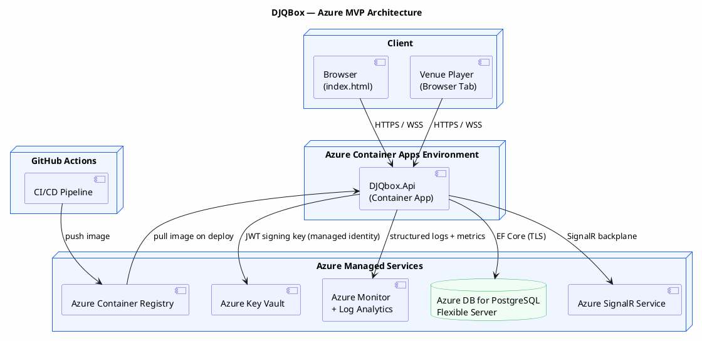

# DJQBox — MVP Azure Promotion Plan

## Purpose

This document describes the promotion path from the local POC to a production-grade MVP running on Azure. It maps each logical DJQBox component to the appropriate Azure service, defines what changes between POC and MVP, and provides a task breakdown for the promotion work.

It is intended to be handed to a coding agent or developer after the POC is validated locally.

---

## What Changes, What Stays the Same

### Stays the same
- All .NET application code (Minimal API, EF Core, SignalR, domain logic)
- All endpoint contracts and data shapes (spec-defined, cloud-agnostic)
- SignalR hub protocol
- All integration tests (run against a local Postgres in CI)
- The dummy frontend (`index.html`) — may be hosted on Azure Static Web Apps

### Changes in MVP

| POC | MVP |
|---|---|
| `docker compose up` on local machine | Azure Container Apps (managed container runtime) |
| Postgres in Docker container | Azure Database for PostgreSQL — Flexible Server |
| In-process SignalR backplane (single instance) | Azure SignalR Service (managed, scales across instances) |
| In-process veto timer (`IHostedService`) | Azure Service Bus (timer messages) or keep in-process for MVP |
| Static JWT signing key in `appsettings` | Azure Key Vault (secret reference in container env) |
| Stdout logs | Azure Monitor + Log Analytics workspace |
| Tokens pre-seeded | Real JWT auth with Azure AD B2C or a lightweight identity flow |
| Local file tracks (seeded DB) | Extend to Spotify adapter (optional for MVP) |
| Manual `docker compose` deploy | GitHub Actions CI/CD → Azure Container Registry → Container Apps |

---

## Azure Architecture



---

## Azure Service Mapping

| Spec Component | POC (local) | Azure MVP |
|---|---|---|
| API Gateway + all services | Single .NET process | Azure Container Apps (single revision for MVP) |
| PostgreSQL database | Docker `postgres:16` | Azure Database for PostgreSQL Flexible Server (Burstable B2ms for MVP) |
| Event Bus / SignalR backplane | In-process (single instance) | Azure SignalR Service (serverless mode) |
| Container registry | Local Docker daemon | Azure Container Registry (Basic tier) |
| Secrets (JWT key) | `appsettings.Development.json` | Azure Key Vault + Managed Identity (no secret in code) |
| Logging | Stdout | Azure Monitor + Log Analytics + Application Insights |
| Frontend hosting | Local file open in browser | Azure Static Web Apps (free tier) or CDN-hosted |
| CI/CD | Manual `docker compose` | GitHub Actions workflow |
| Auth (MVP) | Static pre-seeded tokens | Azure AD B2C (guest flow) or lightweight custom JWT with Key Vault key |

---

## What MVP Adds to the POC

### Must-haves for MVP

1. **Real auth flow** — At minimum: owner login via email/password or Azure AD B2C; guest QR join with a generated token URL (not a static token). See `docs/spec/05-auth-spec.md`.

2. **Multi-venue support** — Venue CRUD endpoints (`POST /venues`, `GET /venues`, etc.). Each venue has its own queue and mode.

3. **Azure SignalR Service backplane** — Replace in-process SignalR hub backplane with Azure SignalR Service so the API can scale to multiple Container App replicas.

4. **Key Vault for secrets** — JWT signing key, database connection string, and any API keys stored in Key Vault. Container App uses Managed Identity to access them. No secrets in environment variables or code.

5. **CI/CD pipeline** — GitHub Actions workflow that: builds the Docker image, pushes to Azure Container Registry, updates the Container App revision.

6. **Structured logging to Azure Monitor** — Serilog sink for Application Insights (`Serilog.Sinks.ApplicationInsights`). Dashboard showing request rates, error rates, queue operations per minute.

7. **HTTPS enforced** — Container Apps provides TLS termination. Enforce HTTPS redirect in the app.

8. **Database migrations in CI** — Run `dotnet ef database update` as part of the deployment pipeline, not at app startup (safer for production).

### Nice-to-haves for MVP (not required for first Azure deploy)

- Spotify adapter integration
- Music Profile scoring (from `docs/spec/07-music-profile-spec.md`)
- Full WebAuthn/passkey owner auth
- Observability spec implementation (from `docs/spec/11-observability-spec.md` — to be written)

---

## Task Breakdown

### Task A — Azure Infrastructure Setup (Bicep / CLI)

**Goal:** All Azure resources provisioned reproducibly via Bicep templates or Azure CLI scripts. No manual portal clicking.

**Resources to create:**
```
Resource Group: rg-djqbox-mvp

Azure Container Registry: crdjqboxmvp (Basic)
Azure Database for PostgreSQL Flexible Server: psql-djqbox-mvp
  - SKU: Burstable B2ms (2 vCores, 8GB RAM)
  - Postgres 16
  - Admin user stored in Key Vault
  - Private access or public with firewall rule for Container Apps outbound IPs

Azure Key Vault: kv-djqbox-mvp
  - Secret: JwtSigningKey
  - Secret: DbConnectionString

Azure SignalR Service: sigr-djqbox-mvp
  - Tier: Free (for MVP)
  - Service mode: Serverless or Default

Azure Container Apps Environment: cae-djqbox-mvp
  - Log Analytics workspace attached

Azure Container App: ca-djqbox-api
  - Image: crdjqboxmvp.azurecr.io/djqbox-api:latest
  - Managed Identity: system-assigned (for Key Vault access)
  - Min replicas: 1, Max replicas: 3
  - Ingress: external HTTPS, port 8080

Azure Static Web Apps: swa-djqbox-frontend (Free tier)
  - Source: /frontend/index.html
```

**Acceptance:** `az deployment group create --template-file infra/main.bicep` provisions all resources. `az containerapp show` reports `Running`.

---

### Task B — SignalR Service Backplane

**Goal:** Replace in-process SignalR with Azure SignalR Service so multiple API replicas share the same hub connection pool.

**Changes to `DJQbox.Api`:**
1. Add NuGet: `Microsoft.Azure.SignalR`
2. In `Program.cs`, replace `builder.Services.AddSignalR()` with:
   ```csharp
   builder.Services.AddSignalR()
       .AddAzureSignalR(builder.Configuration["Azure:SignalR:ConnectionString"]);
   ```
3. Connection string sourced from Key Vault via environment variable injection.
4. Hub endpoint mapping stays the same (`/hubs/venue`).
5. Frontend: no change needed — SignalR JS client connects to the same URL.

**Acceptance:** Deploy two Container App replicas. Connect two browser tabs via SignalR. Submit a recommendation from one tab; confirm the other tab receives the event (proving cross-replica fan-out works).

---

### Task C — Real Auth (JWT with Key Vault Key)

**Goal:** Replace static pre-seeded tokens with a real JWT issuance flow. Signing key is in Key Vault, accessed via Managed Identity.

**Scope for MVP (minimum viable):**

1. **Owner login:** `POST /auth/login` accepts `{ email, password }`. Returns JWT. (Simple credential store in DB for MVP — no WebAuthn yet. WebAuthn deferred to post-MVP.)
2. **Guest join:** `POST /venues/{id}/join` accepts `{ venue_token }`. Venue token is a JWT signed by the deployment key, embedded in a QR URL. Admin generates it via `POST /venues/{id}/token`.
3. **Key Vault integration:** `TokenService` uses `Azure.Security.KeyVault.Secrets` + `DefaultAzureCredential` to fetch the signing key. Key is cached in memory with a 1-hour TTL.

**Acceptance:** Owner logs in, gets a real JWT. Guest joins via generated token URL. Static seeded tokens no longer work in the MVP environment.

---

### Task D — CI/CD Pipeline (GitHub Actions)

**Goal:** Merge to `main` triggers build → test → push image → deploy to Container Apps.

**`.github/workflows/deploy.yml` steps:**
```yaml
on:
  push:
    branches: [main]

jobs:
  build-and-deploy:
    runs-on: ubuntu-latest
    steps:
      - uses: actions/checkout@v4
      - uses: azure/login@v1
        with:
          creds: ${{ secrets.AZURE_CREDENTIALS }}
      - name: Build and push image
        run: |
          az acr build --registry crdjqboxmvp \
            --image djqbox-api:${{ github.sha }} \
            ./src/DJQbox.Api
      - name: Run database migrations
        run: |
          # Run migrations via a one-off container or dotnet-ef tool
          dotnet ef database update \
            --connection "${{ secrets.DB_CONNECTION_STRING }}"
      - name: Deploy to Container Apps
        run: |
          az containerapp update \
            --name ca-djqbox-api \
            --resource-group rg-djqbox-mvp \
            --image crdjqboxmvp.azurecr.io/djqbox-api:${{ github.sha }}
```

**Acceptance:** Merge a change to `main`. GitHub Actions completes successfully. `az containerapp show` reports the new image digest. Changes visible at the Container App URL.

---

### Task E — Observability

**Goal:** Structured logs, health endpoint, and basic Application Insights dashboard.

**Implementation:**
1. Add Serilog Application Insights sink: `Serilog.Sinks.ApplicationInsights`
2. Configure in `Program.cs` to write to Application Insights when `APPLICATIONINSIGHTS_CONNECTION_STRING` env var is set.
3. Add `GET /health` and `GET /health/ready` endpoints:
   - `/health` → `{ status: "ok" }` (liveness)
   - `/health/ready` → checks DB connectivity → `{ status: "ok" | "degraded", db: "ok" | "error" }` (readiness)
4. Container App health probes configured to use `/health` (liveness) and `/health/ready` (readiness).
5. Application Insights dashboard: request rate, error rate, `RecommendationPromoted` custom event count, `QueueAdvanced` custom event count.

Full observability spec will be defined in `docs/spec/11-observability-spec.md`.

**Acceptance:** Azure Portal → Application Insights → Live Metrics shows requests flowing. Failed request logs appear in Log Analytics with `RequestId` correlation.

---

### Task F — Frontend Hosting (Azure Static Web Apps)

**Goal:** `index.html` served from Azure Static Web Apps. API URL configurable via a `config.js` or environment variable baked into the page.

**Changes to `index.html`:**
- Replace hardcoded `http://localhost:8080` with a configurable `API_BASE_URL` loaded from a `config.js` file:
  ```html
  <script src="/config.js"></script>
  <!-- config.js: window.API_BASE_URL = "https://ca-djqbox-api.azurecontainerapps.io"; -->
  ```
- Static Web Apps deployment: `swa deploy ./frontend --env production`

**Acceptance:** Open the Static Web Apps URL in a browser. Full POC flow works against the Azure-hosted API.

---

## Environment Variables Reference

All secrets injected as Container App environment variables sourced from Key Vault references:

| Variable | Source | Description |
|---|---|---|
| `ConnectionStrings__Default` | Key Vault | Postgres connection string |
| `Jwt__SigningKey` | Key Vault | HS256 signing key |
| `Azure__SignalR__ConnectionString` | Key Vault | Azure SignalR Service connection string |
| `APPLICATIONINSIGHTS_CONNECTION_STRING` | Key Vault | Application Insights |
| `ASPNETCORE_ENVIRONMENT` | Container App setting | `Production` |
| `ASPNETCORE_URLS` | Container App setting | `http://+:8080` |

---

## Cost Estimate (MVP, low traffic)

| Resource | Tier | Est. Monthly Cost |
|---|---|---|
| Azure Container Apps | Consumption plan, ~1M requests/month | ~$5–15 |
| Azure Database for PostgreSQL | Burstable B2ms | ~$30–40 |
| Azure SignalR Service | Free (20 units) | $0 |
| Azure Container Registry | Basic | ~$5 |
| Azure Key Vault | Standard, <10k operations | ~$1 |
| Azure Static Web Apps | Free | $0 |
| Azure Monitor / Log Analytics | Pay-per-GB, ~1GB/month | ~$3 |
| **Total** | | **~$45–65/month** |

Costs drop significantly with reserved instances or if PostgreSQL is replaced with Azure SQL serverless. Review before production commitment.

---

## Definition of Done (MVP)

The MVP is complete when:

- [ ] All Azure resources provisioned via Bicep/CLI scripts (no manual portal steps).
- [ ] `https://ca-djqbox-api.azurecontainerapps.io/health` returns `200`.
- [ ] Owner can log in via `POST /auth/login` and receive a real JWT.
- [ ] Guest can join a venue via a generated QR token URL.
- [ ] Full POC flow (recommendation → queue → now-playing) works against the Azure API.
- [ ] Two browser tabs connected via Azure SignalR Service receive events cross-replica.
- [ ] GitHub Actions pipeline deploys on merge to `main`.
- [ ] Application Insights shows request traces and custom domain events.
- [ ] No secrets in source code or committed config files.
- [ ] HTTPS enforced on all endpoints.
