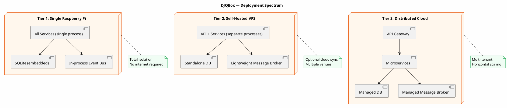
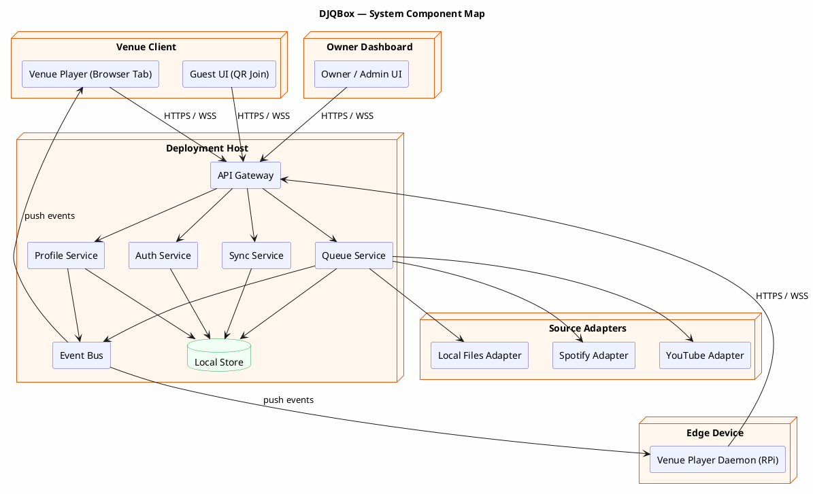

# DJQBox — System Overview & Glossary

## Mission Statement

DJQBox is a cloud-enabled, local-first web application for collaborative music control across physical venues. It provides a unified interface for managing what plays in a café, restaurant, workspace, or home — abstracting over multiple audio sources, supporting both a hands-on DJ and a self-steering Autopilot operating mode, and running on hardware as modest as a Raspberry Pi or as large as a distributed cloud deployment. DJQBox is designed so that the venue owner retains full control and data ownership: the cloud is an option, not a requirement.

---

## Design Principles

### 1. Local-First
Offline operation is the default, not a fallback. The local copy of all data is the primary source of truth. The application functions fully without network connectivity. Sync to cloud or peer devices is additive.

### 2. Cloud-Enabled
Cloud infrastructure enhances DJQBox — enabling multi-device sync, remote management, and scalable multi-venue deployments — but is never required. A deployment on a single Raspberry Pi with no internet connection is fully supported and equally valid.

### 3. Source-Agnostic
DJQBox has no hard dependency on any music source. Spotify, YouTube, local files, and any future source are interchangeable behind the Source Adapter interface. The core system operates on canonical Track references regardless of origin.

### 4. Venue-Isolated
Each venue is an independent namespace. Queues, music profiles, guest access, and playback state are scoped to their venue. No cross-venue data leakage is possible by design.

### 5. Mode-Driven Queue
The queue operates in one of two explicit modes at any time: DJ Mode (an admin controls what plays; guests submit recommendations) or Autopilot Mode (recommendations auto-promote after a configurable veto window). Mode is a first-class property of a venue.

### 6. Privacy by Default
No data leaves the deployment host unless the operator explicitly configures sync or cloud features. Guests require no account. Venue access tokens are signed by the deployment host own key.

### 7. CRDT-Ready
The data model and sync protocol are designed from the start to support a future upgrade to Conflict-free Replicated Data Types. The current last-write-wins strategy is a stepping stone, not a permanent decision.

---

## Deployment Spectrum

DJQBox runs across a spectrum of deployment targets. The logical architecture is identical at all tiers; only the runtime hosting changes.

---

## System Component Map

---

## Glossary

**Autopilot Mode** — A venue operating mode in which recommendations submitted by guests are automatically promoted to the queue after the Veto Window expires, unless an admin casts a veto before the deadline.

**Capability Flag** — A boolean property declared by a Source Adapter or Venue Player at registration time, indicating whether it supports a specific operation (e.g. `streaming`, `offline_cache`, `volume_control`).

**Deployment Host** — The physical or virtual machine (or cluster of machines) running the DJQBox services. Deployment-tier-agnostic: a single Raspberry Pi and a cloud cluster are both valid deployment hosts.

**DJ Mode** — A venue operating mode in which a designated admin (the DJ) has full control over the queue. Guests may submit Recommendations; the DJ decides whether each is accepted or rejected.

**Event Bus** — The internal messaging backbone of DJQBox. Services publish events; consumers (including Venue Players) subscribe. In-process on single-node deployments; a message broker on distributed deployments.

**Music Profile** — A per-venue data structure encoding the sonic identity of a venue. Contains weighted mood tags, genre tags, BPM range, energy range, and an explicit-content flag. Used to score Recommendations and updated by a feedback loop.

**Now Playing** — The QueueItem currently being played by the Venue Player. A venue has at most one Now Playing item at a time.

**Queue** — The ordered list of QueueItems scheduled for playback at a venue. Each venue has exactly one active queue.

**QueueItem** — A single entry in a Queue, representing a Track scheduled or currently playing. Contains TrackRef, position, status, and metadata about who added it.

**Recommendation** — A suggestion by a guest or admin to add a specific Track to the queue. In DJ Mode, reviewed by the DJ. In Autopilot Mode, auto-promotes after the Veto Window.

**Source Adapter** — A software component that translates between DJQBox canonical data model and a specific external music source. Adapters implement a standard interface and register at startup.

**Sync Epoch** — A monotonically increasing logical counter marking a peer position in the delta sync history. Two peers exchange deltas "since epoch N" and advance to N+1 on successful sync.

**Track** — A canonical representation of a piece of audio content. Contains metadata (title, artist, duration, BPM, energy, mood tags, genre tags) normalized from the originating source by the Source Adapter.

**TrackRef** — The minimal identifier for a track: a `(source_adapter, source_id)` pair. The stable cross-system identifier used wherever a full Track record is not needed.

**User** — An actor in DJQBox. Three roles: Owner (manages venues, full admin access, authenticates via OAuth or passkey), Admin/DJ (manages a venue queue, elevated by owner), Guest (joins via QR/token, no account required).

**Venue** — A named, isolated namespace representing a physical location where DJQBox controls music playback. Each venue has its own queue, music profile, operating mode, and access control list.

**Venue Player** — A software component controlling audio output at a venue. Implements the Venue Player interface. Reference implementations: Browser Tab Player and Daemon Player (e.g. Raspberry Pi).

**Veto** — An admin action that blocks a pending Recommendation from being promoted in Autopilot Mode, or signals rejection in DJ Mode. A vetoed recommendation cannot be re-promoted.

**Veto Window** — The configurable time period after a Recommendation is submitted during which an admin may cast a Veto. When it expires without a veto, the recommendation auto-promotes. Default: 60 seconds.

---

## Document Index

| Document | Title | Description |
|---|---|---|
| `spec/00-overview.md` | System Overview & Glossary | Principles, deployment spectrum, component map, glossary. |
| `spec/01-prd.md` | Product Requirements Document | Goals, personas, user stories, acceptance criteria. |
| `spec/02-architecture.md` | System Architecture | Component architecture, data flows, quality attributes. |
| `spec/03-data-model.md` | Canonical Data Model | Entities, fields, relationships, ER diagram, CRDT annotations. |
| `spec/04-api-contracts.md` | API Contracts | REST endpoints, WebSocket channels, error schema, sequence diagrams. |
| `spec/05-auth-spec.md` | Auth Specification | Owner, admin, guest auth flows; token model; offline; revocation. |
| `spec/06-queue-spec.md` | Queue Mechanics | DJ Mode and Autopilot Mode state machines; veto window; mode switch. |
| `spec/07-music-profile-spec.md` | Music Profile | Tag taxonomy, scoring algorithm, feedback loop, ML interface. |
| `spec/08-venue-player-spec.md` | Venue Player Interface | Abstract interface, reference implementations, conformance checklist. |
| `spec/09-sync-spec.md` | Sync Specification | Offline behavior, delta sync protocol, CRDT upgrade path. |
| `spec/10-source-adapter-spec.md` | Source Adapter Interface | Adapter interface, capability flags, reference adapters, conformance. |
| `adr/ADR-001-local-first-sync-strategy.md` | ADR-001: Local-First Sync Strategy | Epoch-based delta sync with LWW/HLC. |
| `adr/ADR-002-queue-conflict-resolution.md` | ADR-002: Queue Conflict Resolution | Fractional index positions for CRDT-compatible ordering. |
| `adr/ADR-003-venue-player-abstraction.md` | ADR-003: Venue Player Abstraction | Abstract player interface over browser, daemon, and future players. |
| `adr/ADR-004-source-adapter-pattern.md` | ADR-004: Source Adapter Pattern | Anti-corruption layer for all music sources. |
| `adr/ADR-005-auth-model.md` | ADR-005: Auth Model | Three-tier auth: owner OAuth/passkey, admin elevation, guest QR token. |
| `adr/ADR-006-music-profile-and-ml-layer.md` | ADR-006: Music Profile & ML Layer | Tag-weight scoring with pluggable ML interface. |
| `adr/ADR-007-crdt-readiness.md` | ADR-007: CRDT Readiness | Data model and operation log for future CRDT upgrade. |
| `adr/ADR-008-deployment-topology.md` | ADR-008: Deployment Topology | Cloud-enabled not cloud-required; RPi to distributed cloud. |
