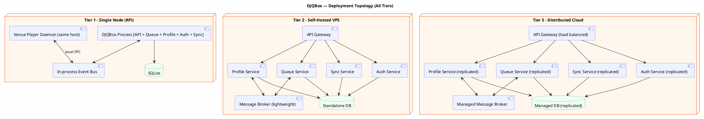
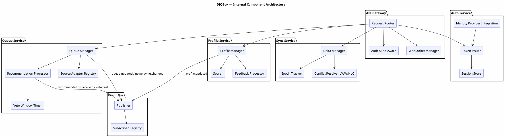
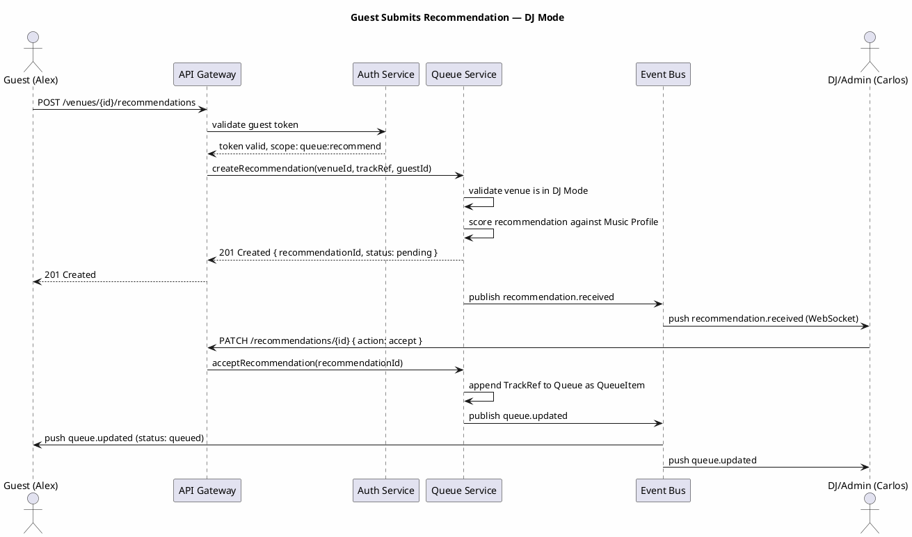
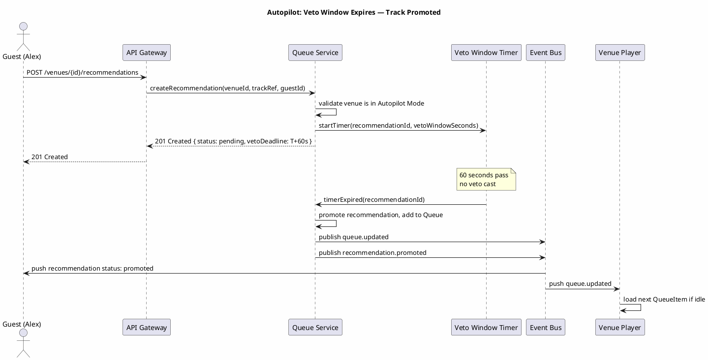

# DJQBox — System Architecture

## Overview

DJQBox follows a service-oriented architecture where logical service boundaries are consistent across all deployment tiers. On a single Raspberry Pi, all services run as modules within one process, sharing an in-process event bus and an embedded database. On a distributed cloud deployment, each service is an independently deployed unit communicating over a network message broker. The architectural contracts — interfaces, events, and data shapes — are identical regardless of tier.

The guiding principle is that **deployment topology is a runtime concern, not an architectural one**. Core abstractions (Venue Player interface, Source Adapter interface, Event Bus contract) do not change when the deployment changes.

---

## Deployment Topology

---

## Component Architecture

---

## Data Flow — Key Scenarios

### Scenario 1: Guest Submits a Recommendation in DJ Mode

### Scenario 2: Autopilot Veto Window Expires — Track Promoted

---

## Service Descriptions

### API Gateway
**Responsibility:** Single entry point for all client traffic. Routes requests to internal services, enforces authentication via Auth Service middleware, manages WebSocket connections, and fans out push events from the Event Bus to connected clients.
**Inputs:** HTTP requests and WebSocket connections from Owner Dashboard, Guest UI, Venue Player clients.
**Outputs:** HTTP responses, WebSocket push events.
**Data owned:** None. Stateless.

### Queue Service
**Responsibility:** Manages the queue for each venue, processes recommendations, runs the Veto Window timer in Autopilot Mode, controls QueueItem lifecycle (pending to playing to played/skipped), and dispatches to Source Adapters to resolve stream URLs.
**Inputs:** Queue operation commands from API Gateway; timer callbacks from Veto Window Timer; playback state events from Venue Players.
**Outputs:** `queue.updated`, `nowplaying.changed`, `recommendation.received`, `recommendation.promoted`, `veto.cast` events on the Event Bus.
**Data owned:** Queue, QueueItem, Recommendation, Veto.

### Profile Service
**Responsibility:** Manages the Music Profile for each venue, scores incoming recommendations against the active profile, processes feedback events (play, skip, veto) to update profile weights.
**Inputs:** Profile read/write commands from API Gateway; playback feedback events from Queue Service.
**Outputs:** `profile.updated` events on the Event Bus; recommendation compatibility scores returned synchronously.
**Data owned:** MusicProfile, ProfileFeedbackEvent.

### Auth Service
**Responsibility:** Handles all identity and authorization. Issues and validates tokens for owners (OAuth/passkey), admins (elevated venue scope), and guests (QR-derived venue token). Manages session lifecycle and revocation.
**Inputs:** Auth commands from API Gateway (login, token validation, refresh, revocation).
**Outputs:** Signed tokens; session records.
**Data owned:** User, Session, VenueMembership.

### Sync Service
**Responsibility:** Manages delta sync between the local store and remote peers or cloud. Tracks sync epochs per peer, computes delta sets since a given epoch, applies incoming deltas with HLC-based conflict resolution, and triggers full sync when epoch gaps are detected.
**Inputs:** Sync request commands from API Gateway; local write events (to build delta log).
**Outputs:** Delta payloads; epoch acknowledgements.
**Data owned:** SyncEpoch, delta operation log.

### Event Bus
**Responsibility:** Decouples event producers from event consumers. On single-node deployments, this is an in-process pub/sub mechanism. On distributed deployments, this is a message broker.
**Inputs:** Published events from any service.
**Outputs:** Delivered events to all registered subscribers.
**Data owned:** In-flight events only; no persistent storage required.

---

## Edge Devices — Venue Player Integration

Venue Players (browser tab or daemon) integrate with the system as follows:

1. **Registration:** The player sends a registration request to `POST /api/v1/venues/{id}/players` at startup, declaring its type, capabilities, and version. The server responds with a `player_id` and a scoped player token.
2. **Command reception:** The player subscribes to the Event Bus (via WebSocket) for events scoped to its venue. When a `queue.updated` event is received and the player is idle, it fetches the next QueueItem and begins playback.
3. **Heartbeat:** The player sends a `player.heartbeat` WebSocket message every 15 seconds. If the server receives no heartbeat for 45 seconds (3x interval), it marks the player as offline and emits a `player.offline` event.
4. **State reporting:** The player emits `stateChanged` events when playback state changes (playing, paused, error). The server reflects this in the Now Playing state.

---

## Quality Attributes

### Offline Resilience
All queue operations, playback control, and recommendation processing function without network connectivity. Local state is the primary source of truth. Sync occurs opportunistically when connectivity is restored.

### Horizontal Scalability (Tier 3 only)
On distributed deployments, the Queue Service, Profile Service, and Auth Service are stateless (state in the database; coordination via Event Bus) and can be horizontally scaled. This attribute is not relevant or required for Tier 1 or Tier 2.

### Extensibility
New Source Adapters and Venue Player implementations can be added without modifying any core service. Both use a registration-at-startup pattern and a defined interface contract.

### Privacy by Default
No data leaves the deployment host unless the operator configures a remote sync target. Guest sessions are scoped to a single venue. No telemetry is collected.

### Single-Node Deployability
The entire system — all services, event bus, database, and a Venue Player daemon — runs on a Raspberry Pi 4 with 4GB RAM, consuming under 500MB RAM under normal load.

---

## Single-Node vs Distributed Operation

| Concern | Single Node (Tier 1) | Distributed (Tier 3) |
|---|---|---|
| Service boundaries | Module boundaries in one process | Network boundaries between processes |
| Event Bus | In-process function call / in-memory queue | Network message broker |
| Database | SQLite (embedded, single file) | Managed relational or document store |
| Auth token signing | Key stored in local file | Key stored in secrets manager |
| Venue Player | Daemon on same host, local IPC | Remote device via WebSocket |
| Sync | Not applicable (no remote) | Epoch-based delta sync to cloud or peer |
| Scaling | Vertical only | Horizontal (add service replicas) |
