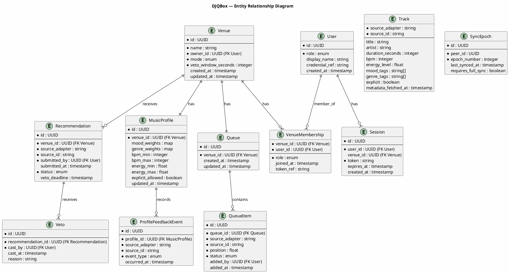

# DJQBox — Canonical Data Model

## Overview

The DJQBox data model defines the canonical entities shared across all services and deployment tiers. Every entity uses a globally unique identifier (UUID v4). All timestamps are stored in UTC as ISO 8601 strings. The model is storage-engine agnostic: it can be realized in a relational database, a document store, or an embedded key-value store. CRDT-readiness annotations indicate which fields and entities are candidates for conflict-free replication in a future upgrade.

---

## Entity-Relationship Diagram

---

## Entity Definitions

### Venue

| Field | Type | Nullable | Constraints | CRDT Note |
|---|---|---|---|---|
| id | UUID | No | Primary key | Immutable after creation |
| name | string | No | 1-100 characters | LWW-Register |
| owner_id | UUID | No | Foreign key to User | Immutable after creation |
| mode | enum: `dj`, `autopilot` | No | Default: `autopilot` | LWW-Register |
| veto_window_seconds | integer | No | 10-3600; default 60 | LWW-Register |
| created_at | timestamp (UTC) | No | Immutable after creation | — |
| updated_at | timestamp (UTC) | No | Updated on any field change | HLC timestamp |

---

### User

| Field | Type | Nullable | Constraints | CRDT Note |
|---|---|---|---|---|
| id | UUID | No | Primary key | Immutable |
| role | enum: `owner`, `admin`, `guest` | No | — | LWW-Register |
| display_name | string | Yes | Max 80 characters | LWW-Register |
| credential_ref | string | Yes | Opaque ref to auth credential; null for guests | LWW-Register |
| created_at | timestamp (UTC) | No | Immutable | — |

---

### VenueMembership

| Field | Type | Nullable | Constraints | CRDT Note |
|---|---|---|---|---|
| venue_id | UUID | No | Foreign key to Venue; composite PK | — |
| user_id | UUID | No | Foreign key to User; composite PK | — |
| role | enum: `owner`, `admin`, `guest` | No | — | LWW-Register |
| joined_at | timestamp (UTC) | No | — | — |
| token_ref | string | Yes | Reference to QR token that granted access (guests only) | — |

---

### Session

| Field | Type | Nullable | Constraints | CRDT Note |
|---|---|---|---|---|
| id | UUID | No | Primary key | — |
| user_id | UUID | No | Foreign key to User | — |
| venue_id | UUID | Yes | Null for owner sessions; set for venue-scoped sessions | — |
| token | string | No | Signed token (opaque to client) | — |
| expires_at | timestamp (UTC) | No | — | — |
| created_at | timestamp (UTC) | No | — | — |

---

### Queue

| Field | Type | Nullable | Constraints | CRDT Note |
|---|---|---|---|---|
| id | UUID | No | Primary key | — |
| venue_id | UUID | No | Foreign key to Venue; unique | — |
| created_at | timestamp (UTC) | No | Immutable | — |
| updated_at | timestamp (UTC) | No | Updated on any queue change | HLC timestamp |

---

### QueueItem

| Field | Type | Nullable | Constraints | CRDT Note |
|---|---|---|---|---|
| id | UUID | No | Primary key | — |
| queue_id | UUID | No | Foreign key to Queue | — |
| source_adapter | string | No | Identifies the source adapter | — |
| source_id | string | No | Source-specific track identifier | — |
| position | float | No | Fractional index; supports insert-without-renumber | LSEQ/RGA-compatible |
| status | enum: `pending`, `playing`, `played`, `skipped` | No | Default: `pending` | LWW-Register |
| added_by | UUID | Yes | Foreign key to User; null for system-generated items | — |
| added_at | timestamp (UTC) | No | — | HLC timestamp |

**Position note:** Uses a fractional index (e.g. 1.0, 1.5, 2.0) rather than integer ordinals. Inserting between positions 1.0 and 2.0 yields 1.5, requiring no renumbering. This design is compatible with LSEQ/RGA sequence CRDTs.

---

### Track

Track is a metadata cache record. It is keyed by `(source_adapter, source_id)` — the TrackRef composite key.

| Field | Type | Nullable | Constraints | CRDT Note |
|---|---|---|---|---|
| source_adapter | string | No | Part of composite PK | Immutable |
| source_id | string | No | Part of composite PK | Immutable |
| title | string | Yes | Max 500 characters | LWW-Register |
| artist | string | Yes | Max 500 characters | LWW-Register |
| duration_seconds | integer | Yes | Positive integer | LWW-Register |
| bpm | integer | Yes | 0-250 | LWW-Register |
| energy_level | float | Yes | 0.0-1.0 | LWW-Register |
| mood_tags | string[] | Yes | Values from defined taxonomy | OR-Set candidate |
| genre_tags | string[] | Yes | Values from defined taxonomy | OR-Set candidate |
| explicit | boolean | Yes | — | LWW-Register |
| metadata_fetched_at | timestamp (UTC) | Yes | When the Source Adapter last populated metadata | — |

---

### TrackRef

TrackRef is a value type used in other entities, not a stored entity.

| Field | Type | Constraints |
|---|---|---|
| source_adapter | string | Identifies the Source Adapter |
| source_id | string | Source-specific identifier |

A TrackRef uniquely identifies a track across all sources. The combination `(source_adapter, source_id)` maps to a Track metadata record.

---

### Recommendation

| Field | Type | Nullable | Constraints | CRDT Note |
|---|---|---|---|---|
| id | UUID | No | Primary key | — |
| venue_id | UUID | No | Foreign key to Venue | — |
| source_adapter | string | No | Part of TrackRef | — |
| source_id | string | No | Part of TrackRef | — |
| submitted_by | UUID | No | Foreign key to User | — |
| submitted_at | timestamp (UTC) | No | — | HLC timestamp |
| status | enum: `pending`, `accepted`, `rejected`, `promoted`, `expired` | No | Default: `pending` | LWW-Register |
| veto_deadline | timestamp (UTC) | Yes | Set when status becomes `pending` in Autopilot Mode | — |

---

### Veto

| Field | Type | Nullable | Constraints | CRDT Note |
|---|---|---|---|---|
| id | UUID | No | Primary key | — |
| recommendation_id | UUID | No | Foreign key to Recommendation | — |
| cast_by | UUID | No | Foreign key to User | — |
| cast_at | timestamp (UTC) | No | — | HLC timestamp |
| reason | string | Yes | Max 500 characters | — |

The set of Vetoes for a Recommendation is an OR-Set CRDT candidate. In the current LWW model, a veto once cast is immutable.

---

### MusicProfile

| Field | Type | Nullable | Constraints | CRDT Note |
|---|---|---|---|---|
| id | UUID | No | Primary key | — |
| venue_id | UUID | No | Foreign key to Venue; unique | — |
| mood_weights | map(string, float) | No | Keys from mood taxonomy; values 0.0-1.0; sum normalized | LWW-Map candidate |
| genre_weights | map(string, float) | No | Keys from genre taxonomy; values 0.0-1.0; sum normalized | LWW-Map candidate |
| bpm_min | integer | No | 0-250; default 0 | LWW-Register |
| bpm_max | integer | No | 0-250; default 250 | LWW-Register |
| energy_min | float | No | 0.0-1.0; default 0.0 | LWW-Register |
| energy_max | float | No | 0.0-1.0; default 1.0 | LWW-Register |
| explicit_allowed | boolean | No | Default: false | LWW-Register |
| updated_at | timestamp (UTC) | No | — | HLC timestamp |

---

### ProfileFeedbackEvent

| Field | Type | Nullable | Constraints | CRDT Note |
|---|---|---|---|---|
| id | UUID | No | Primary key | — |
| profile_id | UUID | No | Foreign key to MusicProfile | — |
| source_adapter | string | No | Part of TrackRef | — |
| source_id | string | No | Part of TrackRef | — |
| event_type | enum: `play`, `skip`, `veto`, `complete` | No | — | Append-only log |
| occurred_at | timestamp (UTC) | No | — | HLC timestamp |

This is an append-only event log. Events are never updated or deleted (only compacted after a threshold). It is the input to the feedback loop that updates MusicProfile weights.

---

### SyncEpoch

| Field | Type | Nullable | Constraints | CRDT Note |
|---|---|---|---|---|
| id | UUID | No | Primary key | — |
| peer_id | UUID | No | Identifies the remote peer (device or cloud node) | — |
| epoch_number | integer | No | Monotonically increasing per peer | — |
| last_synced_at | timestamp (UTC) | No | Wall clock of last successful sync | — |
| requires_full_sync | boolean | No | True when peer epoch is before compaction horizon | — |

---

## Relationships

- A **Venue** has exactly one **Queue** and exactly one **MusicProfile**.
- A **Venue** is owned by one **User** (owner role) and may have many **VenueMembership** records for admins and guests.
- A **Queue** contains zero or more **QueueItems**, each referencing a TrackRef.
- A **Venue** receives zero or more **Recommendations**. Each Recommendation may have zero or more **Vetoes**.
- A **MusicProfile** records zero or more **ProfileFeedbackEvents** that drive its weight updates.
- A **User** may have zero or more **Sessions**, each scoped to a venue (or unscoped for owner sessions).

---

## CRDT Upgrade Notes

The following entities and fields are CRDT upgrade candidates when the system moves beyond last-write-wins:

| Entity / Field | CRDT Type | Reason |
|---|---|---|
| QueueItem.position | LSEQ / RGA | Ordered sequence; concurrent inserts need conflict-free positioning |
| Veto (set per Recommendation) | OR-Set | Concurrent veto additions from multiple admins |
| MusicProfile.mood_weights | LWW-Map or PN-Counter per key | Concurrent weight updates from feedback loop |
| MusicProfile.genre_weights | LWW-Map or PN-Counter per key | As above |
| Track.mood_tags | OR-Set | Concurrent tag additions/removals from adapters |
| Track.genre_tags | OR-Set | As above |
| ProfileFeedbackEvent | Append-only G-Set | Events are immutable once written; merge is union |

To enable the CRDT upgrade, every write operation is recorded in the operation log (SyncEpoch delta log) as a timestamped operation entry alongside the resulting state. Switching from state-sync to operation-log-sync is the only upgrade step required.
