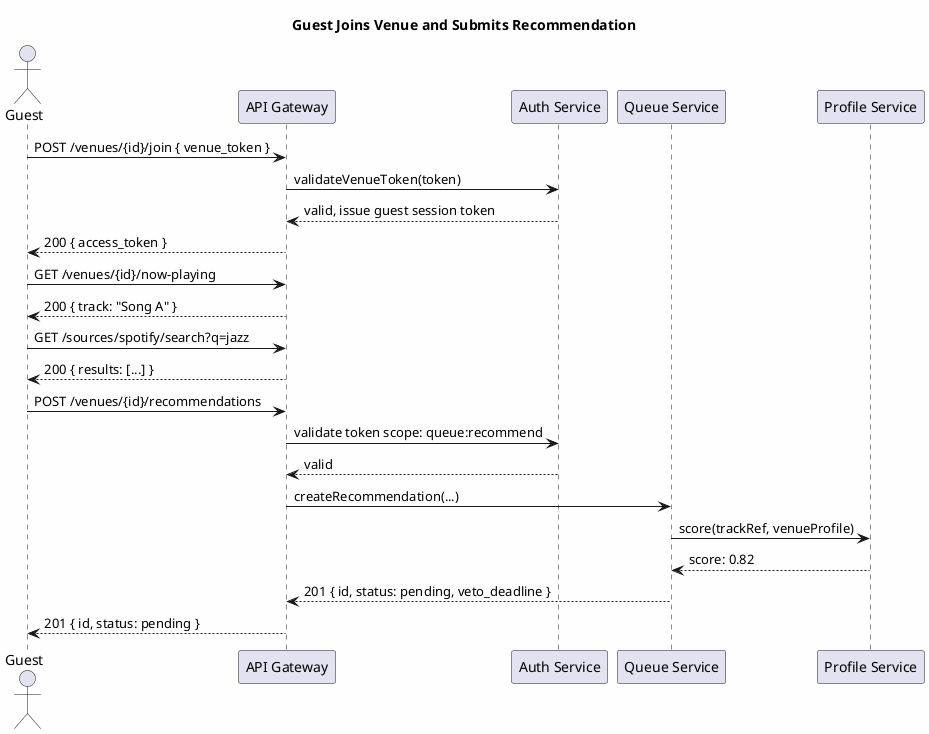
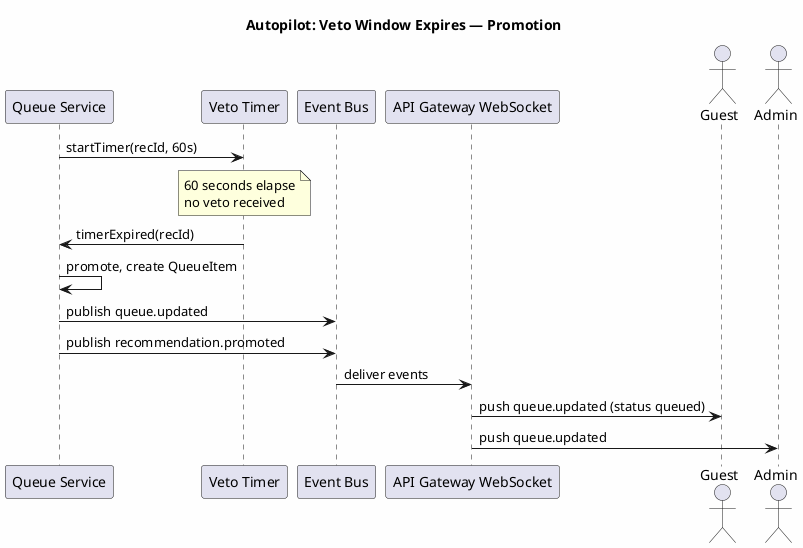

# DJQBox — API Contracts

## Overview

DJQBox exposes a versioned HTTP/WebSocket API. All REST endpoints are under the `/api/v1/` prefix. All request and response bodies are JSON (`Content-Type: application/json`). Authentication is via Bearer token in the `Authorization` header. WebSocket connections are established at `/ws/v1/` and carry JSON-encoded event messages.

---

## Authentication

All endpoints except `POST /auth/register`, `POST /auth/login`, and `POST /venues/{id}/join` require a valid Bearer token.

```
Authorization: Bearer <token>
```

| HTTP Status | Code | Meaning |
|---|---|---|
| 401 | `UNAUTHORIZED` | Token missing or invalid |
| 403 | `FORBIDDEN` | Token valid but insufficient scope |
| 419 | `TOKEN_EXPIRED` | Token has expired; refresh required |

---

## Standard Error Schema

```json
{
  "error": {
    "code": "VALIDATION_ERROR",
    "message": "Human-readable description",
    "detail": { "field": "name", "issue": "required" }
  }
}
```

---

## Standard Pagination

| Parameter | Type | Default | Description |
|---|---|---|---|
| `page_size` | integer | 20 | Number of items per page (max 100) |
| `cursor` | string | — | Opaque cursor from previous response |

Response envelope:
```json
{
  "data": [],
  "meta": {
    "total": 42,
    "page_size": 20,
    "next_cursor": "eyJpZCI6Ii4uLiJ9"
  }
}
```

---

## REST Endpoints

### Auth

#### POST /api/v1/auth/register
Register a new owner account.

Request:
```json
{
  "display_name": "Maria",
  "credential_type": "passkey",
  "credential_data": {}
}
```
Response 201:
```json
{ "user_id": "uuid", "access_token": "...", "refresh_token": "..." }
```

#### POST /api/v1/auth/login
Request: `{ "credential_type": "passkey", "credential_data": {} }`
Response 200: `{ "access_token": "...", "refresh_token": "...", "expires_in": 3600 }`

#### POST /api/v1/auth/refresh
Request: `{ "refresh_token": "..." }`
Response 200: `{ "access_token": "...", "expires_in": 3600 }`

#### DELETE /api/v1/auth/session
Response 204: No content.

---

### Venues

#### POST /api/v1/venues
Create a venue. Requires owner scope.
Request: `{ "name": "The Morning Café", "description": "Chill morning vibes" }`
Response 201: `{ "id": "uuid", "name": "...", "mode": "autopilot", "veto_window_seconds": 60, "created_at": "..." }`

#### GET /api/v1/venues
List all venues owned by the authenticated user.
Response 200: Paginated list of venue objects.

#### GET /api/v1/venues/{venueId}
Response 200: Venue object. | 404: `VENUE_NOT_FOUND`

#### PATCH /api/v1/venues/{venueId}
Update venue settings. Requires owner or admin scope.
Request (any subset): `{ "name": "string", "mode": "dj | autopilot", "veto_window_seconds": 60 }`
Response 200: Updated venue object.

#### DELETE /api/v1/venues/{venueId}
Requires owner scope. Response 204: No content.

---

### Venue Membership

#### POST /api/v1/venues/{venueId}/join
Guest join via QR token. No auth required.
Request: `{ "venue_token": "signed-token-from-qr-code" }`
Response 200: `{ "access_token": "...", "expires_in": 86400 }`
Response 401: `INVALID_VENUE_TOKEN` | 410: `VENUE_TOKEN_REVOKED`

#### GET /api/v1/venues/{venueId}/members
List members. Requires admin scope.

#### DELETE /api/v1/venues/{venueId}/members/{userId}
Remove a member. Requires owner scope. Response 204.

#### POST /api/v1/venues/{venueId}/token
Generate or rotate the QR access token. Requires owner or admin scope.
Response 200: `{ "venue_token": "...", "qr_url": "https://host/join/{token}" }`

---

### Queue

#### GET /api/v1/venues/{venueId}/queue
Response 200:
```json
{
  "queue_id": "uuid",
  "items": [
    {
      "id": "uuid",
      "position": 1.0,
      "status": "pending",
      "track": { "source_adapter": "spotify", "source_id": "...", "title": "...", "artist": "..." },
      "added_by": "uuid",
      "added_at": "2025-07-01T09:05:00Z"
    }
  ]
}
```

#### POST /api/v1/venues/{venueId}/queue/items
Add item directly. Requires admin scope.
Request: `{ "source_adapter": "spotify", "source_id": "3n3Ppam7vgaVa1iaRUIOKE" }`
Response 201: QueueItem object.

#### DELETE /api/v1/venues/{venueId}/queue/items/{itemId}
Requires admin scope. Response 204.

#### PATCH /api/v1/venues/{venueId}/queue/items/{itemId}/position
Reorder. Requires admin scope.
Request: `{ "position": 1.5 }`
Response 200: Updated QueueItem.

---

### Now Playing

#### GET /api/v1/venues/{venueId}/now-playing
Response 200:
```json
{
  "queue_item_id": "uuid",
  "track": { "source_adapter": "...", "source_id": "...", "title": "...", "artist": "...", "duration_seconds": 210 },
  "position_seconds": 45,
  "started_at": "2025-07-01T09:10:00Z"
}
```
Response 204: Nothing currently playing.

---

### Recommendations

#### POST /api/v1/venues/{venueId}/recommendations
Requires `queue:recommend` scope.
Request: `{ "source_adapter": "spotify", "source_id": "..." }`
Response 201: `{ "id": "uuid", "status": "pending", "veto_deadline": "...", "track": { "title": "...", "artist": "..." } }`
Response 409: `DUPLICATE_RECOMMENDATION`

#### GET /api/v1/venues/{venueId}/recommendations
Requires admin scope.
Query params: `status=pending|accepted|rejected|promoted|expired`
Response 200: Paginated list of Recommendation objects.

#### PATCH /api/v1/venues/{venueId}/recommendations/{recId}
Act on a recommendation. Requires admin scope.
Request: `{ "action": "accept | reject | veto", "reason": "optional string" }`
Response 200: Updated Recommendation. | 409: `RECOMMENDATION_ALREADY_RESOLVED`

---

### Music Profile

#### GET /api/v1/venues/{venueId}/profile
Response 200: MusicProfile object.

#### PUT /api/v1/venues/{venueId}/profile
Requires admin scope.
Request:
```json
{
  "mood_weights": { "chill": 0.8, "energetic": 0.2 },
  "genre_weights": { "jazz": 0.6, "electronic": 0.4 },
  "bpm_min": 60, "bpm_max": 120,
  "energy_min": 0.2, "energy_max": 0.6,
  "explicit_allowed": false
}
```
Response 200: Updated MusicProfile.

---

### Source Search

#### GET /api/v1/sources
List all registered source adapters and capabilities.
Response 200:
```json
{
  "adapters": [
    { "id": "spotify", "name": "Spotify", "capabilities": { "search": true, "streaming": true, "offline_cache": false } },
    { "id": "local_files", "name": "Local Files", "capabilities": { "search": true, "streaming": true, "offline_cache": true } }
  ]
}
```

#### GET /api/v1/sources/{adapterId}/search
Query params: `q` (required), `limit` (default 10, max 50), `bpm_min`, `bpm_max`
Response 200:
```json
{
  "results": [
    { "source_adapter": "spotify", "source_id": "...", "title": "...", "artist": "...", "duration_seconds": 210, "bpm": 95, "explicit": false }
  ]
}
```

---

### Sync

#### GET /api/v1/sync/delta
Query params: `since_epoch=42&peer_id=uuid`
Response 200:
```json
{
  "deltas": [
    { "entity_type": "QueueItem", "entity_id": "uuid", "operation": "upsert", "payload": {}, "timestamp": "2025-07-01T09:00:00.000Z" }
  ],
  "new_epoch": 43,
  "requires_full_sync": false
}
```

#### POST /api/v1/sync/push
Request:
```json
{
  "peer_id": "uuid",
  "since_epoch": 42,
  "deltas": [ { "entity_type": "...", "entity_id": "uuid", "operation": "upsert", "payload": {}, "timestamp": "..." } ]
}
```
Response 200: `{ "accepted": 5, "rejected": 0, "new_epoch": 43 }`

---

## WebSocket Channels

Connection: `wss://host/ws/v1?token=<access_token>&venue_id=<venueId>`

All messages are JSON objects with an `event` field.

### `queue.updated`
Direction: Server to Client. When: Any queue change.
```json
{ "event": "queue.updated", "venue_id": "uuid", "changed_item_ids": ["uuid"], "timestamp": "..." }
```

### `nowplaying.changed`
Direction: Server to Client. When: Now-playing track changes.
```json
{ "event": "nowplaying.changed", "venue_id": "uuid", "queue_item_id": "uuid", "track": { "title": "...", "artist": "..." }, "timestamp": "..." }
```

### `recommendation.received`
Direction: Server to admins only. When: New recommendation submitted.
```json
{ "event": "recommendation.received", "venue_id": "uuid", "recommendation_id": "uuid", "track": { "title": "...", "artist": "..." }, "submitted_by": "Guest", "veto_deadline": "..." }
```

### `veto.cast`
Direction: Server to Client. When: A veto is cast.
```json
{ "event": "veto.cast", "venue_id": "uuid", "recommendation_id": "uuid", "timestamp": "..." }
```

### `mode.changed`
Direction: Server to Client. When: Venue mode switches.
```json
{ "event": "mode.changed", "venue_id": "uuid", "new_mode": "autopilot", "timestamp": "..." }
```

### `player.heartbeat`
Direction: Client (Venue Player) to Server. Every 15 seconds.
```json
{ "event": "player.heartbeat", "player_id": "uuid", "venue_id": "uuid", "state": "playing", "timestamp": "..." }
```

---

## Sequence Diagrams

### Guest Joins and Submits Recommendation



### Autopilot Veto Window Expires


