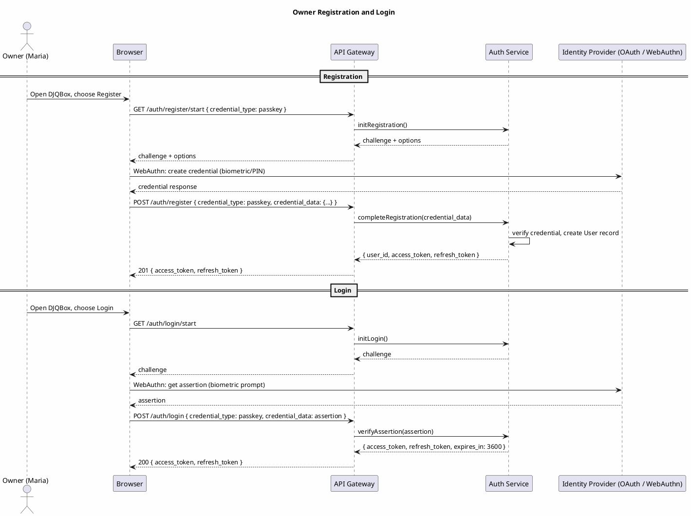
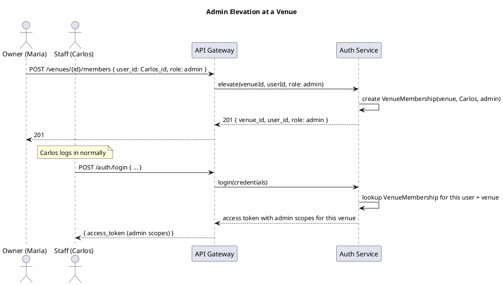
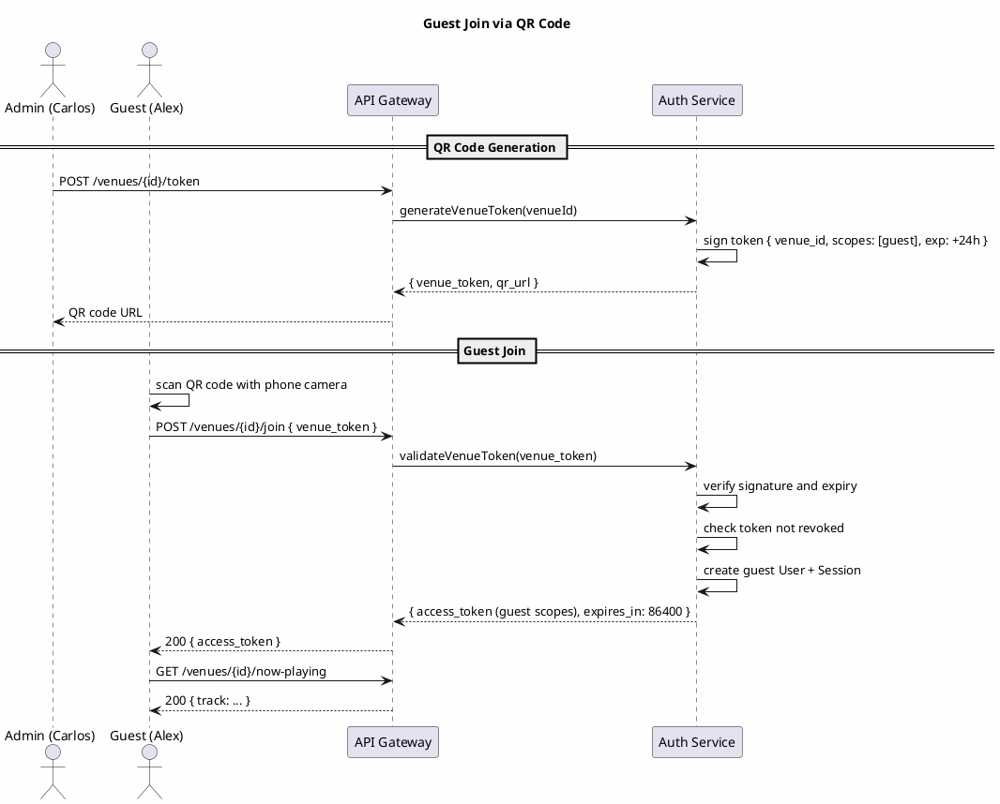

# DJQBox — Auth Specification

## Overview

DJQBox uses a three-tier authentication model matching its three user roles. Authentication is handled by the Auth Service, which issues signed tokens used by all other services. Tokens are signed with a key held by the deployment host — there is no dependency on a third-party token service for offline operation.

All venues are private by default. A guest cannot access any venue data without a valid venue-scoped token. Tokens are designed to be cached locally for offline operation within defined grace periods.

---

## Roles and Scopes

| Role | Description | Scopes |
|---|---|---|
| Owner | Creates and manages venues; full admin rights | `venue:read` `venue:write` `venue:delete` `queue:read` `queue:write` `queue:recommend` `profile:read` `profile:write` `player:control` `member:manage` `sync:full` |
| Admin / DJ | Manages queue and recommendations at a specific venue | `venue:read` `queue:read` `queue:write` `queue:recommend` `profile:read` `profile:write` `player:control` |
| Guest | View now-playing and submit recommendations at one venue | `venue:read` `queue:read` `queue:recommend` |

Scopes are per-venue except for owner-level scopes which span all owned venues.

---

## Token Specification

| Property | Owner Access Token | Admin Access Token | Guest Token |
|---|---|---|---|
| Format | Signed JWT-like (deployment host key) | Signed JWT-like | Signed JWT-like |
| TTL | 1 hour | 8 hours | 24 hours (configurable) |
| Refresh token TTL | 30 days | 7 days | None (re-scan QR) |
| Offline grace period | 7 days | 24 hours | 4 hours |
| Venue-scoped | No (spans all owned venues) | Yes | Yes (single venue) |
| Revocable | Yes | Yes | Yes |

Token claims (minimum required):
```json
{
  "sub": "user_id",
  "role": "owner | admin | guest",
  "venue_id": "uuid | null",
  "scopes": ["venue:read", "queue:recommend"],
  "iat": 1751356800,
  "exp": 1751360400,
  "iss": "djqbox-deployment-host"
}
```

The `iss` claim is the deployment host identifier. Tokens from one deployment host are not valid at another.

---

## Flow 1: Owner Registration and Login



**Narrative:**
1. The Auth Service generates a WebAuthn challenge and returns registration options.
2. The browser prompts the user for biometric/PIN to create a passkey credential.
3. The credential is verified and a User record is created.
4. An access token (1 hour TTL) and refresh token (30 day TTL) are issued.
5. On subsequent logins, an assertion challenge is generated; the passkey device signs it; tokens are issued.
6. When the access token expires, the client sends the refresh token to `/auth/refresh` without user interaction.

**OAuth variant:** Step 2 is replaced by a redirect to the OAuth provider. The Auth Service validates the OAuth callback and issues DJQBox-native tokens.

---

## Flow 2: Admin Elevation



**Narrative:**
1. The owner grants admin role to an existing user at a specific venue.
2. A VenueMembership record is created with role `admin`.
3. On the admin next login, the Auth Service detects VenueMembership and includes admin scopes for that venue.
4. Admin tokens are venue-scoped: Carlos has admin rights at the café but not at the workspace unless separately elevated.
5. The owner can revoke admin access by deleting the VenueMembership record.

---

## Flow 3: Guest Join via QR Code



**Narrative:**
1. An admin generates a QR code. The code encodes a URL containing a signed venue token.
2. The token is signed by the deployment host key and contains `venue_id`, guest scopes, and an expiry.
3. The guest scans the QR code. No app install required.
4. The Auth Service verifies the token, creates an anonymous guest User and Session.
5. A guest access token is issued with `venue:read` and `queue:recommend` scopes for that venue only.

---

## Revocation

### Guest Token Revocation
1. The owner calls `POST /venues/{id}/token` to rotate the venue token. This invalidates the previous token.
2. Existing guest sessions remain valid until their TTL expires unless actively purged.
3. To immediately invalidate all guest sessions: delete all Session records for the venue with role `guest`.
4. Revocation requires connectivity.

### Admin Token Revocation
The owner deletes the VenueMembership record. The admin existing token remains valid until expiry (up to 8 hours). For immediate revocation, purge the specific Session record from the Session store.

### Token Blacklist
A minimal token blacklist (by `jti` claim) is maintained in the local store. Revoked tokens are added and checked on every request. The blacklist is pruned of expired entries on a schedule.

---

## Offline Token Caching

| Token Type | Offline Grace Period | Behavior When Grace Period Expires |
|---|---|---|
| Owner access token | 7 days | Read-only mode; write operations rejected until refresh |
| Admin access token | 24 hours | Queue view and playback continue; writes require reconnection |
| Guest access token | 4 hours | Guest session ends; re-scan QR required |

During offline operation, the system does not check the token blacklist (cannot reach the server). This is an accepted security trade-off documented in ADR-005.

---

## Security Properties

- Venues are private by default. No data is accessible without a valid token.
- Guest tokens grant access to exactly one venue. Cross-venue access is not possible.
- All tokens are signed by the deployment host key. Tokens from another host are rejected.
- Guest tokens contain no persistent user identity.
- No passwords are stored. Owner auth uses WebAuthn (passkey) or delegated OAuth.
- Token signing keys are managed by the deployment host operator.
