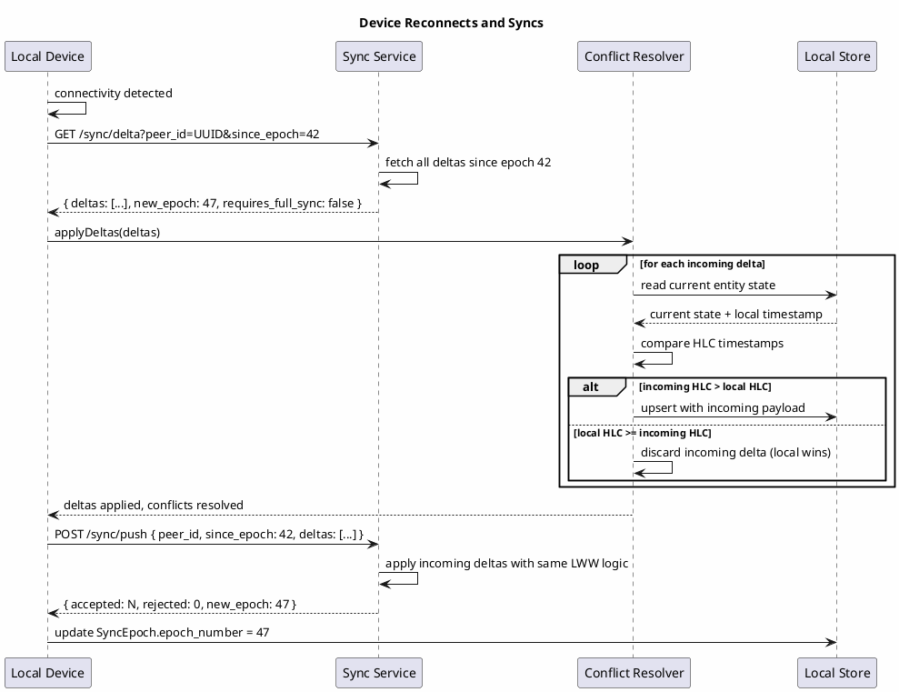

# DJQBox — Sync Specification

## Overview

DJQBox is local-first: the local data store is the primary source of truth. All operations — queue management, recommendations, profile updates, playback control — function fully without network connectivity. Sync to a remote peer or cloud store is opportunistic and additive.

This specification defines what data syncs, how conflicts are resolved, and how the current last-write-wins strategy is designed for a clean upgrade to CRDT-based conflict resolution.

---

## Data Sovereignty

| Entity | Authority | Rationale |
|---|---|---|
| `Venue` (config) | Cloud-authoritative | Owner may manage venues from multiple devices |
| `User` | Cloud-authoritative | User identity must be consistent across devices |
| `VenueMembership` | Cloud-authoritative | Access control decisions must be centrally managed |
| `Session` | Cloud-authoritative | Session validity is server-enforced |
| `Queue` | Local-authoritative | Operated in real time at the venue; latency matters |
| `QueueItem` | Local-authoritative | Same as Queue |
| `Recommendation` | Local-authoritative | Submitted and processed at the venue in real time |
| `Veto` | Local-authoritative | Veto timing is latency-sensitive; must work offline |
| `MusicProfile` | Both (sync) | Set by owner (cloud) and updated by feedback loop (local) |
| `ProfileFeedbackEvent` | Local-authoritative | Events generated at the venue; batch-synced |
| `Track` (metadata) | Both (sync) | Fetched from adapters (cloud); cached locally |
| `SyncEpoch` | Both (sync) | Managed jointly during sync handshake |

**Local-authoritative:** The local node applies mutations immediately without waiting for server confirmation. Mutations are buffered for sync.

**Cloud-authoritative:** The local node reads from cache but defers writes to the server. Writes attempted offline are queued and applied on reconnection; the server result supersedes the local optimistic state.

---

## Offline Behavior

### Queue Operations
All queue operations (add, remove, reorder, accept recommendation, veto) are applied immediately to the local data store. The operation is recorded in the delta log for sync. On reconnection, the delta is pushed to the server. If a conflict is detected (concurrent change by another admin), last-write-wins using HLC timestamp resolves it.

### Recommendations
Recommendations submitted offline are stored locally with `pending` status. The veto timer starts locally. If connectivity is restored before the veto deadline, the recommendation syncs and becomes visible to other clients. If the veto deadline passes offline, the recommendation is promoted locally; the promotion is synced on reconnect.

### Auth Tokens
Tokens are cached locally with the grace periods defined in the Auth Spec. During offline operation, the system does not check the token revocation list. This is an accepted security trade-off (see ADR-005).

### Profile Feedback Events
`ProfileFeedbackEvent` records are written locally immediately. They are batch-synced to the server on reconnection. Weight updates derived from offline events are applied locally and synced as `MusicProfile` state updates.

### Guest Join
Guest join requires connectivity. The QR token must be validated by the Auth Service. If the device is offline, joining a new venue is not possible. Existing guest sessions remain valid for their cached grace period.

---

## Sync Protocol

### Overview
Sync uses an epoch-based delta exchange. Each peer maintains a `SyncEpoch` record per remote peer. A sync cycle consists of:

1. Client sends a `SyncRequest` with its current epoch for the peer.
2. Server responds with all deltas since that epoch.
3. Client applies deltas (with conflict resolution if needed).
4. Client sends its own outgoing deltas.
5. Both peers advance to the new epoch.

### Message Schemas

**SyncRequest:**
```json
{
  "peer_id": "uuid",
  "since_epoch": 42,
  "entity_types": ["QueueItem", "Recommendation", "MusicProfile"]
}
```

**SyncResponse:**
```json
{
  "deltas": [
    {
      "entity_type": "QueueItem",
      "entity_id": "uuid",
      "operation": "upsert",
      "payload": {},
      "timestamp": "2025-07-01T09:05:00.000Z"
    }
  ],
  "new_epoch": 43,
  "requires_full_sync": false
}
```

**Delta object:**
```json
{
  "entity_type": "string",
  "entity_id":   "uuid",
  "operation":   "upsert | delete",
  "payload":     {},
  "timestamp":   "ISO8601 with milliseconds (HLC)"
}
```

**Full sync trigger:** When `requires_full_sync: true`, the client discards its local delta log for this peer and requests a full snapshot of all entities. This occurs when the server's delta log has been compacted beyond the client's `since_epoch`.

---

## Conflict Resolution

The current conflict resolution strategy is **last-write-wins (LWW) using Hybrid Logical Clocks (HLC)**.

### Hybrid Logical Clock (HLC)
An HLC timestamp combines a wall clock time with a logical counter, ensuring that:
- Timestamps are always monotonically increasing, even if the system clock is adjusted.
- Two events on the same node that occur in the same millisecond are distinguishable by their logical counter.

HLC format: `<wall_clock_ms>.<logical_counter>` encoded in the `timestamp` field.

### LWW Rule
When two deltas for the same `(entity_type, entity_id)` field are received with different timestamps:
- The delta with the **higher HLC timestamp** wins.
- The losing delta is discarded.
- Applied field-by-field for map and object fields where possible (field-level LWW).

### Known Limitation
Two admins making concurrent changes to the same queue item (e.g. both reordering position simultaneously) will result in one change being lost. This is acceptable for current deployment scenarios (single venue, low concurrency) and will be addressed by the CRDT upgrade.

---

## Sync Sequence Diagram



---

## CRDT Upgrade Path

The data model and delta log are designed so that upgrading from LWW to CRDTs requires only a change in the merge function, not a data migration.

### CRDT Candidates

| Entity / Field | Recommended CRDT | Reason |
|---|---|---|
| `QueueItem.position` | LSEQ or RGA | Concurrent insertions into an ordered sequence |
| `Veto` (set per Recommendation) | OR-Set | Multiple admins can veto concurrently |
| `MusicProfile.mood_weights` | LWW-Map or PN-Counter per key | Concurrent weight updates from feedback loop |
| `MusicProfile.genre_weights` | LWW-Map or PN-Counter per key | Same as mood_weights |
| `ProfileFeedbackEvent` log | G-Set (append-only) | Events are immutable; merge is union |
| `Track.mood_tags` | OR-Set | Concurrent tag additions/removals from adapters |
| `Track.genre_tags` | OR-Set | Same as mood_tags |

### Operation Log Structure

Every write to a local-authoritative entity produces an operation log entry alongside the state snapshot:

```json
{
  "op_id":       "uuid",
  "entity_type": "QueueItem",
  "entity_id":   "uuid",
  "operation":   "upsert",
  "field_ops": [
    { "field": "position", "op_type": "set", "value": 1.5,     "hlc": "1751356800000.1" },
    { "field": "status",   "op_type": "set", "value": "pending","hlc": "1751356800000.1" }
  ],
  "hlc": "1751356800000.1"
}
```

When the CRDT upgrade is applied:
1. The `field_ops` array is extended with CRDT-specific operation types (`increment`, `decrement`, `add_to_set`, `remove_from_set`).
2. The sync protocol switches from state-delta exchange to operation-log exchange.
3. The merge function is replaced with the CRDT merge for each entity type.
4. No data migration is required because the operation log was maintained alongside state from the start.

### Migration Timeline

| Phase | Strategy | Trigger |
|---|---|---|
| v1 | LWW/HLC on state deltas | Now |
| v2 | Field-level LWW-Map on profile weights | When multi-admin profile conflicts become frequent |
| v3 | Full CRDT on queue ordering (LSEQ) and veto sets (OR-Set) | When multi-admin concurrent queue editing is a product requirement |

---

## Compaction

The delta operation log grows indefinitely without compaction.

- **Compaction horizon:** The server retains deltas for `compaction_window_days` (default: 30 days). Deltas older than the horizon are compacted into a full-state snapshot.
- **Epoch gap:** If a peer's `since_epoch` predates the compaction horizon, `requires_full_sync: true` is returned and the peer performs a full snapshot sync, resetting its epoch.
- **Compaction schedule:** Compaction runs as a background job on the Deployment Host. On Tier 1 (single RPi), compaction runs nightly. On Tier 3, compaction is a scheduled task per entity store.
- **Tombstones:** Deleted entities are retained as tombstone records until the compaction horizon passes, ensuring deletes propagate to all peers before being purged.
